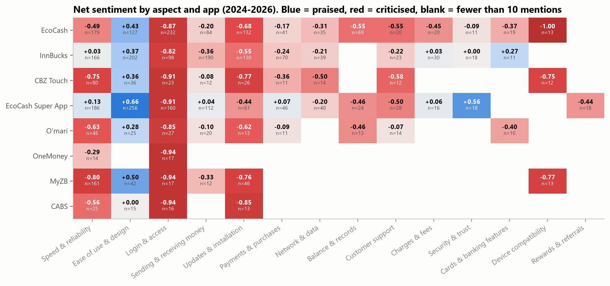

# Aspect-Based Sentiment Analysis of Zimbabwean Money-App Reviews

HCS4112 Natural Language Processing, Great Zimbabwe University

Finds what users praise and complain about in Google Play reviews of eight Zimbabwean mobile-money and banking apps
(EcoCash, EcoCash Super App, InnBucks, O'mari, OneMoney, CBZ Touch, MyZB, CABS). Each sentence is tagged with the
aspects it mentions (login, fees, speed, updates, ...) and the sentiment towards each one. Results can be explored in
a Streamlit app, MariLens.



## How it works

1. **Collect**: reviews are scraped from the Zimbabwe Play Store with `google-play-scraper` (notebook 01).
2. **Clean**: 12 cleaning rules in `src/absa/text.py`: contraction expansion, text-speak, brand masking, emojis to
   tokens, phone/e-mail masking, and an English gloss for common Shona and Ndebele words (notebooks 02-03).
3. **Split**: reviews are split into sentences, and sentences into clauses at contrast words (but, however, asi, kodwa).
4. **Find aspects**: 14 aspects are matched with a lexicon of English, Shona and Ndebele terms, widened with FastText
   embeddings trained on the reviews (`data/lexicons/`, `src/absa/aspects.py`, notebook 04).
5. **Score sentiment**: each aspect's clause is classified as negative, neutral or positive by a TF-IDF (words and
   characters) + logistic regression model trained on star ratings (1-2 negative, 3 neutral, 4-5 positive) (notebook 05).
6. **Evaluate**: three test sets (held-out reviews, the EcoCash Super App, four brands not used in training), VADER and
   a pretrained transformer as baselines, and 250 hand-labelled sentences (notebooks 05-06).
7. **Analyse**: net sentiment per aspect and app, 2024 onwards (notebook 07).

Main results (macro-F1): 0.632 on held-out reviews and 0.632 on unseen brands; 0.642 for aspect-level sentiment on
the hand-labelled set. Full results are in notebooks 05-07 and `reports/tables/`.

## Running it

Tested with Python 3.13.

```
py -3.13 -m venv venv
venv\Scripts\activate            (Linux/Mac: source venv/bin/activate)
pip install -r requirements.txt
python -m pytest -q
streamlit run app/streamlit_app.py
```

Run notebooks 02 to 07 in order. Notebook 01 is the original scrape and is not meant to be re-run. Notebooks 02-07
need `data/raw_reviews.csv`, which is not in this repository (see Data).

Optional transformer baseline: `pip install torch transformers`, then `python scripts/transformer_baseline.py`.

## Project structure

```
01_collect_data.ipynb ... 07_analysis.ipynb   the analysis, in order
src/absa/
    config.py       paths, apps, splits, label rule
    text.py         cleaning rules, tokenisation, sentence and clause splitting
    aspects.py      lexicon-based aspect detection
    embeddings.py   FastText training and lexicon expansion
    scope.py        opinion scope (sentence, clause, dependency parse)
    models.py       feature and classifier pipelines
    evaluate.py     metrics, bootstrap intervals, McNemar test
    baselines.py    majority class, VADER, transformer
    pipeline.py     end-to-end analyser used by notebook 07 and the app
    gold.py, absa_eval.py   gold set and aspect-level evaluation
    clouds.py       word clouds
    viz.py          chart style
app/                MariLens (streamlit_app.py, components.py, style.css, static/)
data/lexicons/      normalisation dictionaries and aspect lexicon
data/gold/          hand-labelled gold set
models/             trained sentiment models (FastText models are rebuilt by notebook 04)
reports/figures/    charts
reports/tables/     result tables
scripts/            transformer baseline
tests/              unit tests
```

## MariLens

- **Wallet**: each app as a card with its mood score (-100 to +100); opens to a per-aspect statement, word cloud and
  latest reviews.
- **Compare**: up to four apps side by side, aspect by aspect.
- **Check a review**: paste any review and see its aspects and sentiment.
- **Find an app**: search the Play Store by name and analyse its newest reviews (needs internet).
- **How it works**: pipeline summary and test results.

## Data

Public Google Play reviews, scraped in October 2026. Usernames and profile images are not stored, and phone numbers,
e-mails and links in review text are masked. The raw and processed review files are kept out of this repository and
are available on request for academic use.
